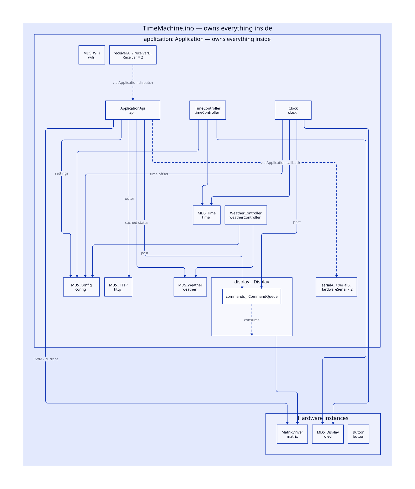
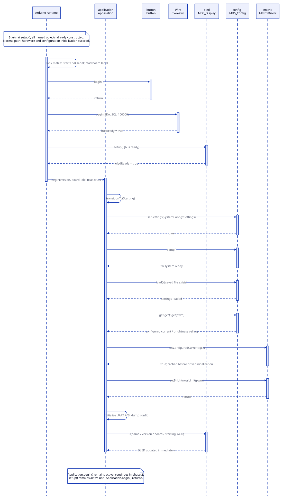
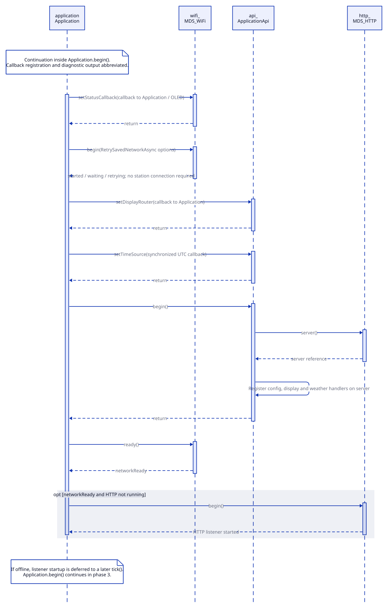
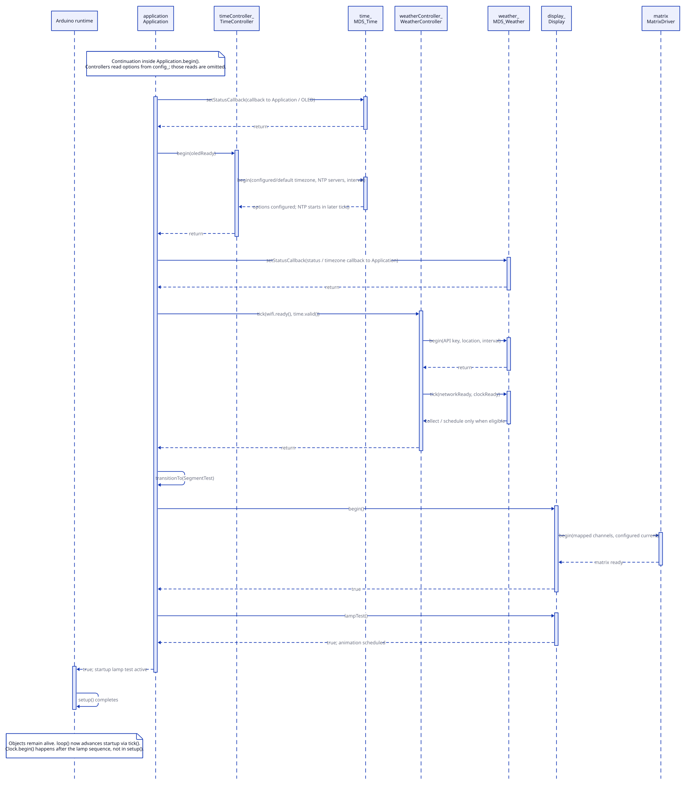
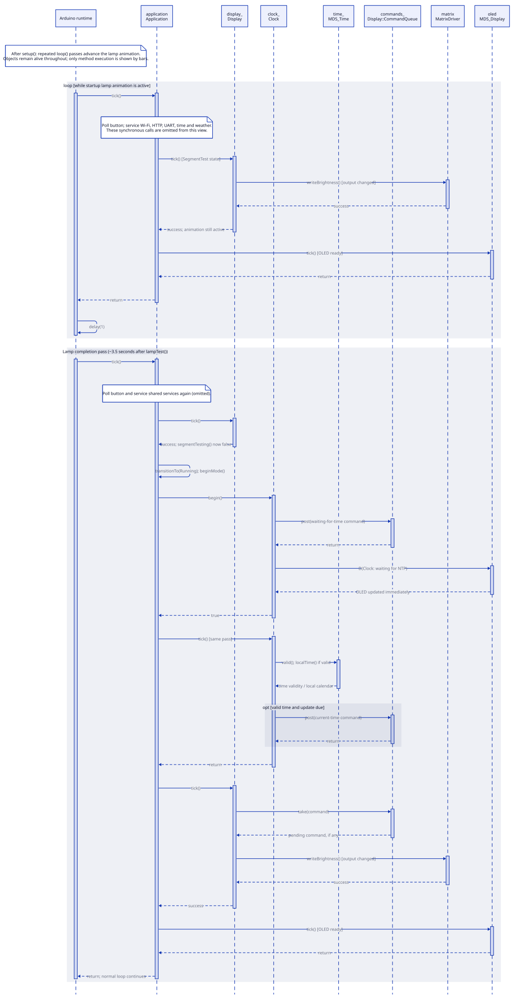

# Firmware Architecture

## Overview

The Time Machine firmware turns a clock display into a configurable timepiece and a remotely controlled display for text and animations. A board can operate on its own or work with connected boards so that one control point can direct several displays.

Any board can connect safely to any other board through an A-to-B link. One board acts as the master, receiving display commands and configuration updates over HTTP and sending them through port A, port B, or both to directly connected boards. Every serial message travels exactly one hop and is never retransmitted. The master also shares timing and Wi-Fi settings to simplify setup and coordinate display behavior. Every board reports its IP to directly connected boards, making those neighbors accessible through the read-only `ipA` and `ipB` configuration values.

The clock starts with the configured timezone, or the default when no timezone is saved. If OpenWeather is configured, a successful query then sets the timezone for the selected location.

`Application` coordinates startup and ongoing work. Clock updates and remote display actions use a shared command queue, while `Display` handles rendering and animation. Configuration, networking, time, weather, and status output use external `MDS_*` libraries. This separates application behavior, display rendering, and reusable services.

The following sections describe the components, object ownership, startup sequence, and communication interfaces that realize this design. The firmware entry point is `TimeMachine.ino`. The current firmware version is `0.5.1`, reported through the read-only `version` field in `/api/config`.

## Classes and Relationships

### Firmware Classes

See [Firmware Classes](Classes.md) for the intent, implementation approach, and key methods of each project class.

| Class | Role | Uses |
| --- | --- | --- |
| `Application` | Starts the firmware, runs services, routes serial messages, and handles the reset button | Hardware objects, application components, and external services |
| `ApplicationApi` | Handles HTTP requests for settings, display actions, and weather; decodes serial display commands and configuration updates | HTTP, configuration, weather, matrix driver, display command queue, and `Application` for serial output |
| `TimeController` | Applies time settings and updates the time service | Configuration, time service, and OLED |
| `WeatherController` | Applies weather settings, updates the service, and applies timezone results | Configuration and weather service |
| `Clock` | Converts offset time into display commands | Configuration, time service, display command queue, and OLED |
| `Display` | Renders text, time, indicators, and animations | Display command queue and matrix driver |
| `MatrixDriver` | Controls the LED driver and its brightness/current settings | I²C bus |
| `Button` | Reads and debounces the physical button | GPIO and timing functions |
| `SerialProtocol::Receiver` | Assembles incoming messages independently on each serial port | Serial protocol definitions |

### External Libraries

| Library | Service provided to the firmware |
| --- | --- |
| `MDS_Config` | Settings, validation, and storage |
| `MDS_WiFi` | Wi-Fi connection and network setup |
| `MDS_HTTP` | HTTP server |
| `MDS_Time` | Network time synchronization and local time conversion |
| `MDS_Weather` | Weather retrieval and cached results |
| `MDS_Display` | Status OLED output |

Display command producers submit commands to a shared queue owned by `Display`. `Display` consumes those commands during its update cycle.

For an HTTP display request, `ApplicationApi` checks the request and sends the command to the selected destinations: the local display, serial port A, or serial port B. It adds local commands to the display queue and asks `Application` to send commands over the serial ports.

For an incoming serial display command, `Application` receives the message and passes it to `ApplicationApi` for decoding. The decoded command goes to the local display queue.

Configuration updates can target the local board, directly connected boards, or all three through HTTP destination selection. Received updates apply locally and are never forwarded. Offset inputs are converted to seconds on the HTTP board before delivery.

Configuration connects several components. `ApplicationApi` handles changes to settings, while the time and weather controllers apply those settings to their services. Display brightness and current settings are applied to `MatrixDriver`.

### Supporting Definitions and Data Structures

Several supporting names are namespaces that group definitions and helper functions. They are not classes and have no object instances to own or initialize.

| Namespace | Contents |
| --- | --- |
| `SystemConfig` | Configuration setting definitions |
| `DisplayMap` | Physical digit and indicator mappings |
| `DisplayGamma` | Brightness conversion tables, constants, and helpers |
| `SevenSegment` and `SixteenSegment` | Segment definitions, font tables, and character mapping helpers |
| `ClockCalendar` | A date/time structure and calendar helpers |
| `SerialProtocol` | Framing, protocol status definitions, and message encoders |

Data structures describe values passed between components: `Display::Frame` holds display output, `Display::DisplayCommand` describes a requested action, `ClockCalendar::DateTime` holds calendar values, and `DisplayMap::Digit` describes the channel mapping for a digit.

## Object Structure

The sketch owns `application`, `matrix`, `oled`, and `button`. `Application` owns its services and controllers and uses the hardware objects supplied by the sketch. `Display` owns the shared display command queue.

In the diagram, boxes inside another box are owned by that enclosing object. The “Hardware instances” box groups objects owned directly by the sketch. Solid arrows show direct use; dashed arrows show command flow or callbacks through `Application`. Calls from `Application` to its components are omitted to keep the diagram readable.

[Diagram Source](diagrams/relationships.d2)

| Instance | Owner | Used by |
| --- | --- | --- |
| `application` — `Application` | Sketch | `setup()` and `loop()` |
| `matrix` — `MatrixDriver` | Sketch | `Application`, `Display`, `ApplicationApi` |
| `oled` — `MDS_Display` | Sketch | `Application`, `TimeController`, `Clock` |
| `button` — `Button` | Sketch | `Application` |
| `display_` — `Display` | `Application` | `Application` |
| `commands_` — `Display::CommandQueue` | `Display` | `Clock`, `ApplicationApi`, `Display` |
| `config_` — `MDS_Config` | `Application` | `Application`, `ApplicationApi`, `TimeController`, `WeatherController`, `Clock` |
| `wifi_` — `MDS_WiFi` | `Application` | `Application` |
| `http_` — `MDS_HTTP` | `Application` | `Application`, `ApplicationApi` |
| `time_` — `MDS_Time` | `Application` | `Application`, `TimeController`, `Clock` |
| `weather_` — `MDS_Weather` | `Application` | `Application`, `WeatherController`, `ApplicationApi` |
| `api_` — `ApplicationApi` | `Application` | `Application` and HTTP request handlers |
| `timeController_` — `TimeController` | `Application` | `Application` |
| `weatherController_` — `WeatherController` | `Application` | `Application` |
| `clock_` — `Clock` | `Application` | `Application` |
| `serialA_`, `serialB_` — `HardwareSerial` | `Application` | `Application` |
| `receiverA_`, `receiverB_` — `SerialProtocol::Receiver` | `Application` | `Application` |
| `Wire` — `TwoWire` | Arduino platform | Sketch, `MatrixDriver`, `MDS_Display` |

The sketch creates `oled`, `matrix`, `button`, and then `application` before `setup()` runs. Creating `application` also creates its member objects. Initialization methods such as `begin()` prepare these existing objects for use; they do not create them.

## Startup Event Flow

Startup has two stages: `setup()` initializes the firmware, then repeated calls from `loop()` advance the lamp animation and start the clock display. Network services continue to run during the animation.

The diagrams show a successful startup. Each object has a vertical lifeline. Activation bars show when a method is executing; solid arrows show calls and dashed arrows show returns. Objects remain alive after startup.

### Hardware and Configuration

The sketch keeps the matrix blank while it initializes the button, serial console, I²C bus, and OLED. It then starts `Application`, passing the hardware readiness results.

`Application` loads settings, applies current and brightness limits to the display, and starts serial ports A and B. It also writes startup status to the OLED.

[Diagram Source](diagrams/startup.d2)

### Wi-Fi and HTTP

`Application` starts Wi-Fi and registers the API request handlers. The HTTP server starts when a Wi-Fi connection is available. Startup can continue while Wi-Fi is connecting or waiting for network setup.

[Diagram Source](diagrams/startup-network.d2)

### Time, Weather, and Display

The time controller first applies the configured timezone or default. The weather controller configures weather retrieval; a successful query later replaces the timezone with the returned offset. `Application` initializes the matrix display and starts the lamp animation. `setup()` returns while that animation is still running.

[Diagram Source](diagrams/startup-services.d2)

### Running Clock

During the lamp animation, `Application::tick()` continues to update the services and display. When the animation finishes, `Application` starts `Clock`. The clock sends display commands as time becomes available, and `Display` renders them during its update cycle.

[Diagram Source](diagrams/startup-loop.d2)

The running clock does not require Wi-Fi or time synchronization to have completed at startup. If the matrix display fails, network and configuration services can continue. A configuration startup failure prevents normal operation.

## Communication

### HTTP

The board provides a JSON API at `http://BOARD_IP` on port 80. All endpoints use GET.

| Endpoint | Purpose |
| --- | --- |
| `/api/config` or `/` | Read local settings and status, or update settings on selected local and serial destinations |
| `/api/display` | Send display actions to this board or either serial port |
| `/api/weather` | Read cached weather and retrieval status |

The API also stores a runtime-only `timeOffset`. Signed unit input or a strict UTC date/time is converted to signed seconds. The clock adds this value to current UTC before local timezone conversion, so each board can show an independent time without changing system time.

See the [API Summary](API-summary.md) for parameters, examples, and responses.

### Serial

The A/B ports carry display commands, configuration updates, timing pings, Wi-Fi credentials, and IP announcements between boards. Serial communication continues while Wi-Fi is unavailable. Each board reports its current IP on both ports; received addresses appear as read-only `ipA` and `ipB` values in the HTTP configuration response. The receiver returns a protocol status on the same port to report framing acceptance or failure; that status does not confirm execution. A primary board supplies timing and network settings; both ports can receive display commands and configuration updates.

See the [Serial Summary](Serial-summary.md) for connections, board roles, and delivery behavior.
